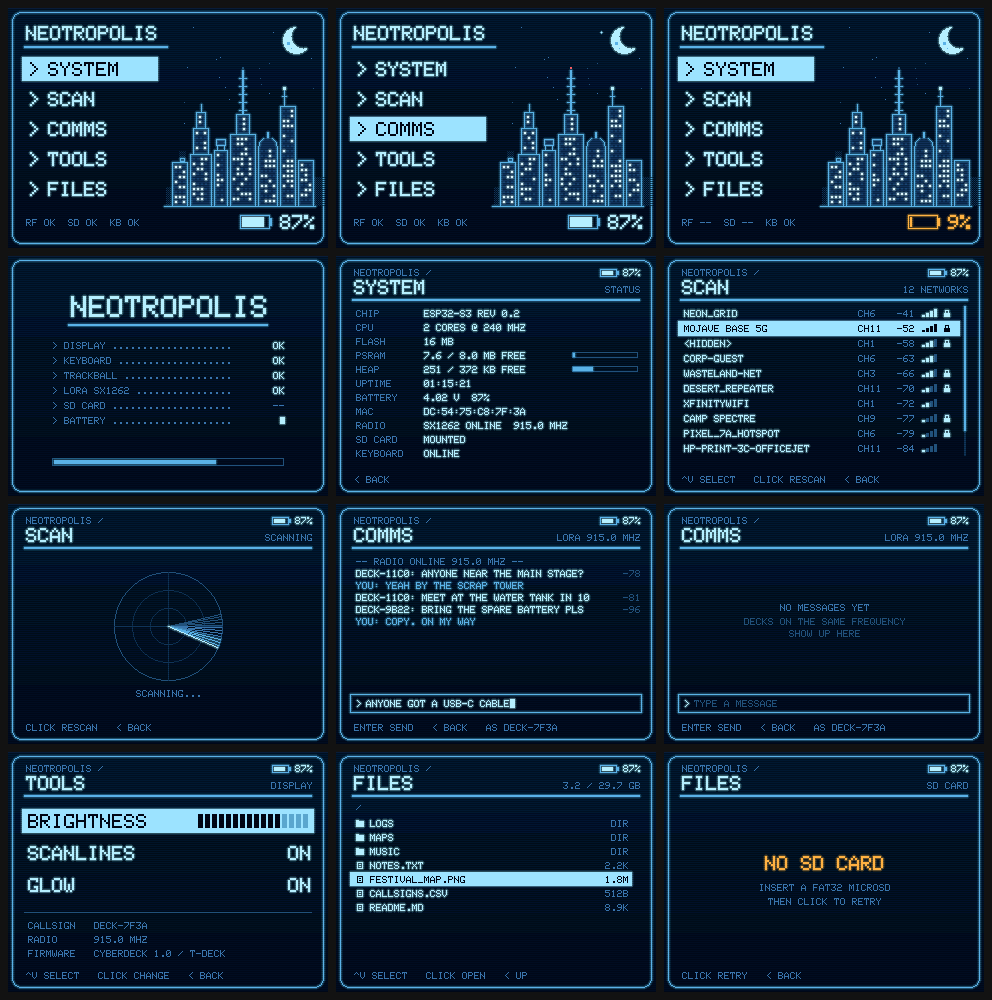

# Cyberdeck firmware for the LILYGO T-Deck

A retro terminal UI for the T-Deck / T-Deck Plus (ESP32-S3, 320×240 screen, keyboard, trackball, LoRa).
It has a cyan-on-navy pixel style with a glowing phosphor look and CRT scanlines, an animated night skyline on the home screen, and five working apps:

| Menu | What it does |
|------|--------------|
| **SYSTEM** | Chip, CPU, flash, live PSRAM/heap use, uptime, battery voltage, MAC, radio/SD/keyboard status |
| **SCAN** | Wi-Fi scanner with a radar sweep, signal bars, channel and lock icon, sorted by strength |
| **COMMS** | Text chat over LoRa with any other deck running this firmware. No Wi-Fi or cell signal needed |
| **TOOLS** | Brightness, scanlines and glow, saved across reboots |
| **FILES** | Browse the microSD card (folders and file sizes) |

An unread-message dot blinks next to COMMS when something arrives while you are on another screen.



## Controls

- Trackball **up/down** moves. **Click** (or **Enter**) selects
- Trackball **left** (or **Backspace**) goes back
- In COMMS, type on the keyboard and press **Enter** to send

## Flash the prebuilt image (no software install)

1. Plug the T-Deck into a computer with USB-C.
2. Put it in download mode: hold the trackball down, press the reset button, then release the trackball.
3. In Chrome or Edge on a computer, open https://espressif.github.io/esptool-js/ and click **Connect**.
4. Set the flash address to **0x0**, choose `dist/cyberdeck-tdeck-0x0.bin`, and click **Program**.
5. Press reset when it finishes.

The prebuilt image uses **915 MHz** LoRa (US). For Europe (868) or Asia (433), build it yourself after changing `config.h`.

## Build it yourself

With [arduino-cli](https://arduino.github.io/arduino-cli/) installed:

```
make setup                 # once: ESP32 core 3.3.12 + RadioLib 7.8.1
make build
make flash PORT=/dev/ttyACM0   # or /dev/cu.usbmodemXXXX on macOS, COM5 on Windows
make preview               # render every screen to build/preview/*.png without hardware
```

With the Arduino IDE 2: install **esp32 by Espressif** (3.x) and **RadioLib**, then open `Cyberdeck/Cyberdeck.ino` and set:
Board **ESP32S3 Dev Module**, USB CDC On Boot **Enabled**, Flash Size **16MB**, PSRAM **OPI PSRAM**,
Partition Scheme **16M Flash (3MB APP/9.9MB FATFS)**.

### Settings in `Cyberdeck/config.h`

- `DECK_TITLE`: the name on the home screen
- `DECK_CALLSIGN`: your chat name. The default is DECK- plus the last 4 hex digits of the MAC
- `LORA_FREQ_MHZ`: **915.0 in the US** and 868.0 in Europe. It must match the band your T-Deck's radio was sold for.
  Every deck that should chat needs the same frequency, bandwidth, spreading factor, coding rate and sync word.

## Developing with Claude Code

`CLAUDE.md` has the architecture, rules, hardware notes and backlog. `HANDOFF.md` has a prompt to paste when you start.

## Credits

The pin map, display init sequence and backlight driver come from LilyGO's T-Deck examples (MIT).
The 5×7 font is from Adafruit GFX (BSD).
