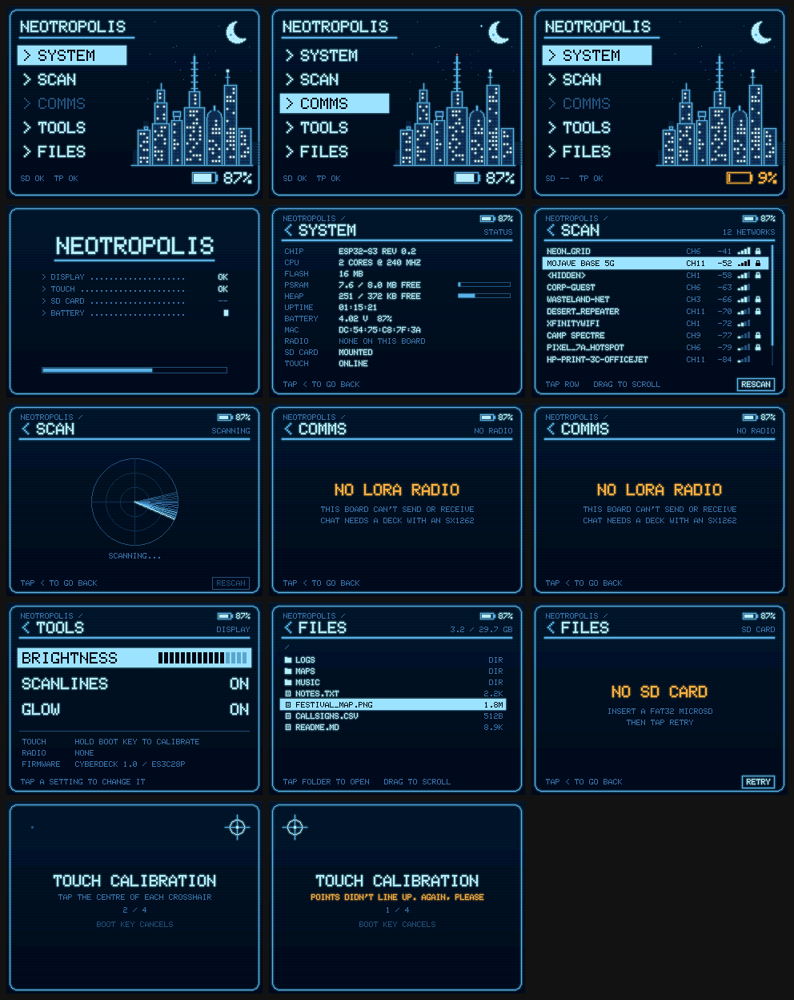

# Cyberdeck firmware for ESP32-S3 handhelds

A retro terminal UI for two ESP32-S3 boards with a 320×240 screen:

- **LCDWiki 2.8" ESP32-S3 display (ES3C28P)**: touchscreen, microSD, BOOT key. This is the default build, and it runs on real hardware.
- **LILYGO T-Deck / T-Deck Plus**: keyboard, trackball, LoRa radio. This build compiles but hasn't been tested on a T-Deck yet.

It has a cyan-on-navy pixel style with a glowing phosphor look and CRT scanlines, an animated night skyline on the home screen,
and five apps:

| Menu | What it does |
|------|--------------|
| **SYSTEM** | Chip, CPU, flash, live PSRAM/heap use, uptime, battery voltage, MAC, radio/SD/input status |
| **SCAN** | Wi-Fi scanner with a radar sweep, signal bars, channel and lock icon, sorted by strength |
| **COMMS** | Text chat over LoRa with any other deck running this firmware (T-Deck). Boards without a radio show why it's unavailable |
| **TOOLS** | Brightness, scanlines and glow, saved across reboots |
| **FILES** | Browse the microSD card (folders and file sizes) |

On the T-Deck, an unread-message dot blinks next to COMMS when something arrives while you are on another screen.

| 2.8" touch board | T-Deck |
|---|---|
|  |  |

## Controls

**Touch board (ES3C28P)**
- **Tap** a menu item or row to open it. **Drag** lists up and down to scroll
- **Tap the `<` title** at the top, or **swipe right**, to go back. A short press on **BOOT** also goes back
- The first boot asks you to tap four crosshairs to line the touch panel up with the screen.
  To redo it later, **hold BOOT for 2 seconds**

**T-Deck**
- Trackball **up/down** moves. **Click** (or **Enter**) selects
- Trackball **left** (or **Backspace**) goes back
- In COMMS, type on the keyboard and press **Enter** to send

## Flash a prebuilt image (no software install)

1. Plug the board into a computer with USB-C.
2. In Chrome or Edge, open https://espressif.github.io/esptool-js/ and click **Connect**.
   If it won't connect, put the board in download mode:
   - 2.8" board: hold **BOOT**, tap **RESET**, release BOOT.
   - T-Deck: hold the trackball down, press reset, release the trackball.
3. Set the flash address to **0x0** and choose the image for your board:
   - `dist/cyberdeck-es3c28p-0x0.bin` for the 2.8" touch board
   - `dist/cyberdeck-tdeck-0x0.bin` for the T-Deck (uses **915 MHz** LoRa, US. For Europe (868) or Asia (433), build it yourself after changing `config.h`)
4. Click **Program**, then press reset when it finishes.

## Build it yourself

With [arduino-cli](https://arduino.github.io/arduino-cli/) installed (macOS: `brew install arduino-cli`):

```
make setup                                   # once: ESP32 core 3.3.12 + RadioLib 7.8.1
make build                                   # 2.8" touch board (BOARD=es3c28p is the default)
make build BOARD=tdeck                       # T-Deck
make flash PORT=/dev/cu.usbmodem1101         # add BOARD=tdeck for a T-Deck; /dev/ttyACM0 on Linux, COM5 on Windows
make monitor PORT=/dev/cu.usbmodem1101       # serial log at 115200
make preview                                 # render every screen for both boards to build/preview/*.png, no hardware needed
```

With the Arduino IDE 2: install **esp32 by Espressif** (3.x), and **RadioLib** if you're building for the T-Deck. Pick the board
with `DECK_BOARD` in `Cyberdeck/config.h`, then open `Cyberdeck/Cyberdeck.ino` and set:
Board **ESP32S3 Dev Module**, USB CDC On Boot **Enabled**, Flash Size **16MB**, PSRAM **OPI PSRAM**,
Partition Scheme **16M Flash (3MB APP/9.9MB FATFS)**.

### Settings in `Cyberdeck/config.h`

- `DECK_BOARD`: `2` = 2.8" ES3C28P (default), `1` = T-Deck. `make build BOARD=...` overrides it
- `DECK_TITLE`: the name on the home screen
- `DECK_CALLSIGN`: your chat name (T-Deck). The default is DECK- plus the last 4 hex digits of the MAC
- `LORA_FREQ_MHZ`: **915.0 in the US** and 868.0 in Europe. It must match the band your T-Deck's radio was sold for.
  Every deck that should chat needs the same frequency, bandwidth, spreading factor, coding rate and sync word.

Pins for each board are in `Cyberdeck/boards.h`.

## Developing with Claude Code

`CLAUDE.md` has the architecture, rules, hardware notes and backlog. `HANDOFF.md` has a prompt to paste when you start.

## Credits

The T-Deck pin map, display init sequence and backlight driver come from LilyGO's T-Deck examples (MIT).
The ES3C28P pin map and ILI9341V init sequence come from LCDWiki's ES3C28P/ES3N28P documentation.
The 5×7 font is from Adafruit GFX (BSD).
